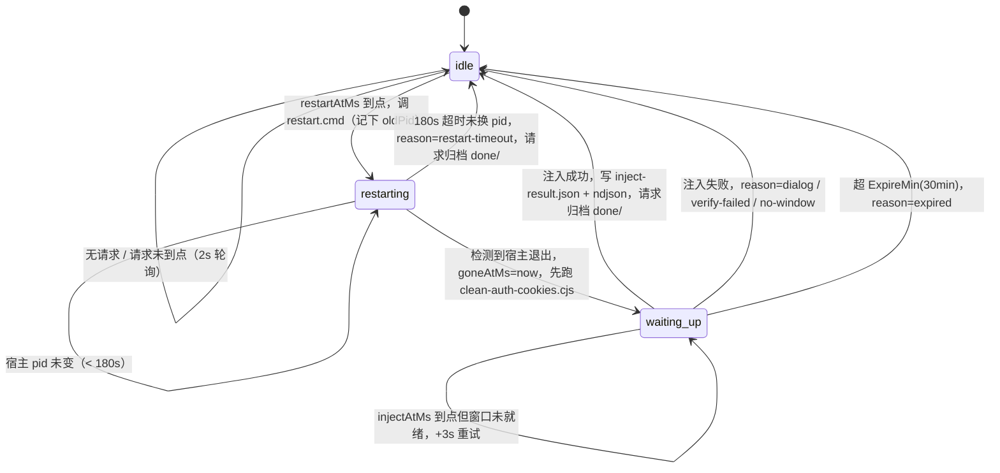
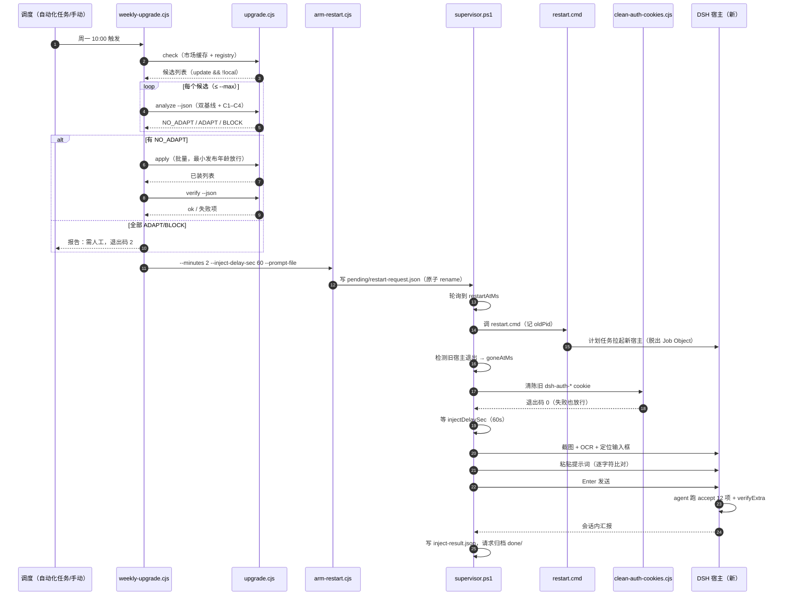

# 流程设计

一条完整链路分五段：**调度 → 执行 → 编排 → 重启 → 验收**。前两段是「判断要不要装」，第三段是「装」，后两段是「让装的东西真正生效并自证」。

---

## ① 调度

三种触发方式，最终都落到同一个入口 `scripts/weekly-upgrade.cjs`：

| 触发 | 配置 | 说明 |
| --- | --- | --- |
| 宿主「自动化任务」 | 每周一 10:00，提示词「跑 weekly-upgrade.cjs 并汇报」 | 主路径。agent 在 DSH 会话里执行，能读报告、能追问 |
| 手动 | 直接命令行 | 排障、验证、临时补装 |
| 计划任务 | `schtasks` / `Register-ScheduledTask` | 宿主没开时的兜底；不注入验收 |

调度层**不做判断**，只负责「到点跑一次编排」。所有决策都在脚本里，这样无论谁来触发，行为一致、可复现。

---

## ② 执行：从「有没有新版本」到「能不能直接装」

`upgrade.cjs` 有六个子命令，编排只用其中四个：

| 子命令 | 作用 | 编排是否使用 |
| --- | --- | --- |
| `check` | 读市场缓存 + registry，列出有新版本的包 | 是 |
| `analyze` | 对单个包做双基线差分 + 四点耦合判定 | 是 |
| `apply` | 安装（含最小发布年龄放行、verify、回写卡片与 history） | 是 |
| `verify` | 校验已装状态 | 是 |
| `contract` | 校验宿主契约（版本、端口、CLI 是否可用） | 间接（apply/verify 内部调用） |
| `inventory` | 列已装插件与版本 | 排障用 |

### 双基线差分

`analyze` 同时算两条线：

- **上游变更**：干净旧版 tarball ↔ 干净新版 tarball。回答「作者改了什么」。
- **本机改动**：干净旧版 tarball ↔ 已装目录。回答「我们本地改过什么」。

两条线的交集才是需要人判断的地方 —— 上游改了、本地也改了，那个文件就是对冲风险点。

### 四点耦合判定（C1–C4）

DSH 插件与宿主之间有四个「隐式契约」，升级时必须逐点检查：

| 点 | 检查内容 | 判 BLOCK 的条件 |
| --- | --- | --- |
| **C1** bundle patch 行 | 包对宿主 bundle 打了哪些 patch 行，新版代码里这些行是否还在 | 行仍在则上游没动，patch 继续有效（不判 BLOCK） |
| **C2** client inject 服务 | 包在 `dsh.client.inject` 里声明的宿主服务是否真实存在 | **声明了但宿主没有** → 启动期该注入不激活 → 崩或白屏 |
| **C3** profile 配置行 | 包写入 profile 的配置项在新版是否仍被识别 | 配置项被移除且无迁移 |
| **C4** 就地补丁锚点 | 包 `patches/` 里的 `+` 行在新包中锚点是否还在 | 锚点丢失且未重打补丁 |

判定结果三态：

- **NO_ADAPT** —— 四点都没碰。可以直接装，不需要任何适配。
- **ADAPT** —— 触及 C1–C4 任一点，但可自动适配（锚点还在、只是内容变了等）。**不自动装**，输出适配说明交人工。
- **BLOCK** —— 硬阻塞（peer/engines 不满足、C2 服务缺失、C4 锚点丢失且未重打）。**不装，且不降级尝试**。

> 判定模块缺失时（例如本仓库未附带 `coupling.cjs`），`analyze` 返回 `UNKNOWN`，四项各标「本项未判定」，`contract` 报 `unavailable` 警告。这是**显式降级**，不是静默放行 —— 编排会把这类包当 ADAPT 处理，不进自动安装。

---

## ③ 编排：只装能装的，装完必须验收

`weekly-upgrade.cjs` 的流水线：

1. **取候选**：读市场缓存 `.dsh-market/discovery-compatibility-v1.json`，叠加 registry 实时 check，过滤出 `update && !local` 的包；按名字排序后 `slice(0, --max)`（默认 4）。`--pkg a@1 b@2` 可强制指定候选（跳过发现阶段）。
2. **逐个 analyze**（`--json`），分成三堆：`block` / `manual`（ADAPT 或 UNKNOWN）/ `auto`（NO_ADAPT）。
3. **批量 apply**：只对 `auto` 堆，且非 dry-run，跑一次 `apply` 批量安装。
4. **verify**：`verify --json`。任一项失败即视为本轮失败。
5. **排重启**：仅当 `verifyOk && applied.length > 0 && restartAfter > 0` 时，调 `arm-restart.cjs` 写重启请求。
6. **写报告**：`reports/weekly-YYYYMMDD.md`（dry-run 加 `-dryrun` 后缀）+ `reports/last-weekly.json`（dry-run 写 `last-dryrun.json`）。

### 放行条件与最小发布年龄

`apply` 只装「发布满最小年龄」的版本，避免上游刚发 5 分钟就踩到回滚版。年龄阈值由 `upgrade.cjs` 内部常量控制，命中过新的版本时该包被跳过并在报告里注明「发布过新，本轮跳过」，不算失败。

### 失败语义与退出码

| 情况 | 退出码 | 说明 |
| --- | --- | --- |
| 全部 verify 通过，且无 manual、无 block | `0` | 成功 |
| 有 manual 或 block，或 verify 失败 | `2` | 需要人看报告 |
| `--dry-run` | `0` / `2` 同上 | 只判定不安装，报告照写 |

**已存在 pending 请求不算失败**：`arm-restart.cjs` 在已有请求时退出码 `3`、stderr 打 `pending request already exists`，编排识别为「已排程」而非错误，也不回落到计划任务兜底。

---

## ④ 重启与注入：由宿主体外的看守发起

### 为什么要看守

宿主自己 `kill` 自己再拉起会失败：子进程在宿主的 Windows Job Object 里，宿主一死进程树一起销毁 —— 症状是「窗口关掉了，新的没起来」。所以必须有一个**不属于宿主进程树**的常驻进程来做重启和注入。`supervisor.ps1` 就是这个进程，由计划任务 `DSH_supervisor`（登录即启、忽略重复实例、无执行时限）拉起。

### 排程

`arm-restart.cjs` 只做一件事：写请求文件。

```
pending/restart-request.json = { id, createdAtMs, restartAtMs, minutes, injectDelaySec, prompt, note }
```

`restartAtMs = now + minutes*60000`。写入是原子的（先写临时文件再 rename），保证看守不会读到半个 JSON。

### 看守状态机

`pending/supervisor-state.json` 保存 `{ phase, id, goneAtMs, injectAtMs, restartAtMs, oldPid }`，三个相位：



关键约束：

- **只有 `idle` 才触发重启。** `restarting` / `waiting_up` 期间到来的新请求只写文件、不叠加动作，杜绝连环重启。
- **重启 180 秒超时。** 调了 `restart.cmd` 但宿主 pid 没换（重启脚本静默失败、计划任务被禁用等）→ 写 `reason=restart-timeout`，请求归档回 `idle`，不无限卡住。
- **`waiting_up` 起算点是「宿主消失」而非「重启命令发出」。** 慢机器上宿主退出可能晚几十秒，用消失时刻起算才不会在旧窗口还活着时就去注入。

### cookie 清理的位置

宿主退出后、新宿主出现前，看守调 `clean-auth-cookies.cjs`。这一步是必须的：桌面壳每次启动随机端口，认证 cookie 按 `dsh-auth-<hash(host:port)>` 命名，同主机不同端口各一条且 30 天不回收。约 70 次重启后 Cookie 头超过 Node 默认 16 KB 上限 → 宿主回 **431** → 桌面壳 welcome 校验失败、崩在启动界面。清理器只删 loopback 主机上的 `dsh-auth-%` 行，保留 365 天的 `dsh_pair`，退出码恒 0（清理失败不能挡启动）。

### 注入

新宿主起来后等 `injectDelaySec`（默认 60 秒，留给插件加载与首屏渲染），然后：

1. 取面积最大的 `MainWindowHandle` 作为目标窗口（多窗口时以面积判主窗）。
2. 截图 → `Windows.Media.Ocr` 出每行文本 + 包围盒 → 写 `evidence-<id>-ocr.txt`。
3. **坏词检查**：命中 `could not start` / `authentication failed` / `Web authentication` / `Diagnostic report` / `is unavailable` / `无法启动` / `身份验证失败` / `不可用` → 判定为对话/错误弹窗，`reason=dialog` 中止，不做注入。
4. **定位输入框**：OCR 命中占位文案（`发消息或创建任务`、`调用指令`、`文件或对话`、`输入消息`、`reply`）任一的中心点；都没命中则兜底取窗口底部中线向上 101 / 140 / 160 px 三个候选点。
5. **逐个试**：点候选点 → `Ctrl+A` → `Delete` → 写剪贴板 → `Ctrl+V` → `Ctrl+A` → `Ctrl+C` → 比对剪贴板与提示词**逐字符完全相等** → 相等则 `Right` + `Enter` 发送；不等则 `Esc` 清除并试下一个点。
6. 全部候选失败 → `reason=verify-failed`，保留 `evidence-<id>-before.png` / `after.png`。
7. 用前保存、用后还原用户剪贴板（不污染用户数据）。

注入成功后写 `pending/inject-result.json` 并追加到 `pending/inject-results.ndjson`，请求文件移到 `pending/done/`，相位回 `idle`。

---

## ⑤ 验收：注入的提示词自己跑完 12 项

注入的提示词就是「升级后自检」，它让新宿主里的 agent 跑 `tools/accept.cjs`，共 12 项：

| # | 检查 |
| --- | --- |
| 1–3 | `verify` 三项（宿主版本、依赖/契约、插件清单一致性） |
| 4 | 当前网卡上 `:19387` 动态端口列表符合预期 |
| 5 | `127.0.0.1:3081` 可达 |
| 6 | `/api/pair/status` 返回 200 |
| 7 | `/api/session.list` 返回 401（未带凭据时应当拒绝，而不是 200） |
| 8 | 本地 Hindsight 服务 `:9077` healthy |
| 9 | `im-connect` 插件版本 1.0.9 |
| 10 | 最近 30 分钟内无 `crash-*.log` |
| 11 | 上次升级的包版本与预期一致 |
| 12 | 插件卡上的 `verifyExtra` 逐条通过 |

全部通过 → 报告「升级成功」；任一项失败 → 报告失败项与证据路径，人再介入。

第 12 项是插件自定义扩展点：插件在卡片里声明 `verifyExtra`，验收脚本逐条执行，让插件自己补充「我这个插件怎样才能算活着」。

---

## 时序图



---

## 两个间隔，三个优先级

| 参数 | 内置默认 | 含义 |
| --- | --- | --- |
| `restartDelayMinutes` | 2 分钟 | 排程到重启之间的缓冲（给正在跑的任务收尾） |
| `injectDelaySec` | 60 秒 | 新宿主起来到开始注入之间的等待（给插件加载与首屏渲染） |

优先级从低到高：

1. **内置默认**（脚本常量）
2. **插件 config 的 `supervisor` 段**（`cordis.patch.yml` 里写的默认值）
3. **用户设置** `~/.dsh/dsh-power/supervisor-settings.json`
   ```json
   { "restartDelayMinutes": 2, "injectDelaySec": 60, "updatedAt": "...", "updatedBy": "settings-page" }
   ```

用户在设置页改的就是第 3 层 —— 改完立即生效，不需要重启看守（看守每轮读一次）。范围校验：分钟 `0–1440`，秒 `0–3600`。单次排程还可以用 `--minutes` / `--inject-delay-sec` 临时覆盖，不影响保存的设置。

---

## 失败分支表

| 阶段 | 失败 | 判定 | 后果 | 人的动作 |
| --- | --- | --- | --- | --- |
| check | registry 不可达 | 该包跳过 | 其余包继续 | 看报告，必要时换 `DSH_UPGRADE_REGISTRY` |
| analyze | 判定为 BLOCK | 不装 | 报告列阻塞点 | 等上游修，或手工适配 |
| analyze | 判定为 ADAPT/UNKNOWN | 不装 | 报告给适配说明 | 人工评估后手动 `apply` |
| analyze | coupling 模块缺失 | UNKNOWN | 降级为 manual | 补上模块或人工确认 |
| apply | 版本过新（未满最小发布年龄） | 跳过 | 下轮再装 | 无 |
| apply | 安装过程中断 | 该包失败 | 其余包继续，报告标失败 | 看 `reports/last-weekly.json` |
| verify | 任一项失败 | 本轮失败 | 不排重启，退出码 2 | 修后重跑 |
| arm | 已有 pending 请求 | 不算失败 | 沿用已有排程 | 无 |
| arm | 写请求失败 | 回落计划任务 | `DSH_restart_after_update` 一次性任务 | 重启后手动发验收 |
| 重启 | 180s 未换 pid | `restart-timeout` | 回 idle，不注入 | 查 `watch.log` 与 `restart.log` |
| 注入 | 窗口未就绪，30 分钟未注入 | `expired` | 放弃本轮注入 | 手动发验收 |
| 注入 | 命中坏词 | `dialog` | 中止，留截图+OCR | 看 `evidence-*.png` |
| 注入 | 候选点都对不上 | `verify-failed` | 中止，留证据 | UI 可能改版，更新候选文案 |
| cookie | 清理失败 | 忽略 | 退出码 0，不挡启动 | 偶发可忽略；持续则看 `cleanup-cookies.log` |

---

## 设计取舍

- **宁可漏装不可装错。** ADAPT 一律不自动装。自动装错的代价是白屏/启动崩，需要人介入且可能丢配置；漏装只是下周再来一次。
- **重启与注入放在同一个看守里。** 拆成两个进程会多一个「谁先谁后」的竞态；一个循环 + 一个状态文件最简单。
- **注入前先 OCR 再点。** 纯坐标点击在 UI 改版后会把提示词打到随机位置（甚至可能触发别的按钮），OCR 至少能保证「我看到的是输入框」。
- **失败必留证据。** 每次注入都存 before/after 截图与 OCR 全文，失败时人不用复现就能判断是 UI 变了还是宿主没起来。
